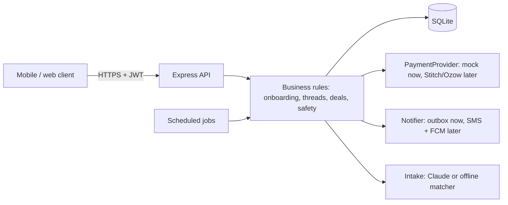

# Architecture

One Node service, one SQLite file. Deliberately simple for the hackathon; every part has a clear production swap (see ROADMAP).

## State machines

**Thread:** open, has_offers, matched, formalised, closed (archived ~7 days after the deal), expired (no match in 7 days).

**Consultation deal:** awaiting_payment, in_progress (money held), completed (released and split), or disputed, then released or refunded.

**Licensing deal:** terms_pending, terms_locked (both locked, hash fixed, affidavits issued), under_review (both verified by staff), formalised (both confirmed). Any change or dispute returns to terms_pending and voids all earlier affidavits.

**Meeting:** proposed, confirmed, in_progress, completed. Escalation ladder runs only for safety-mode meetings past their end time.

## Design decisions worth defending

- **Rules live on the server.** The UI mirrors the gate, but `canPost`, `isEligible` and every state check run in the API.
- **Money is integer cents; payments are idempotent;** a failed booking after a charge triggers a refund (compensation).
- **State change first, payout second.** Releasing funds is atomic; the bank payout follows and is retried, so a bank failure never loses or double-pays money.
- **One matching function** (`isEligible`) drives the feed, the alerts and offer validation, so they can never disagree.
- **Third parties see nothing:** deals, offers and affidavits are visible to the parties only; the counterparty gets a redacted, watermarked, logged view.
- **Archive, never delete** threads and offers: they are evidence in a dispute.
